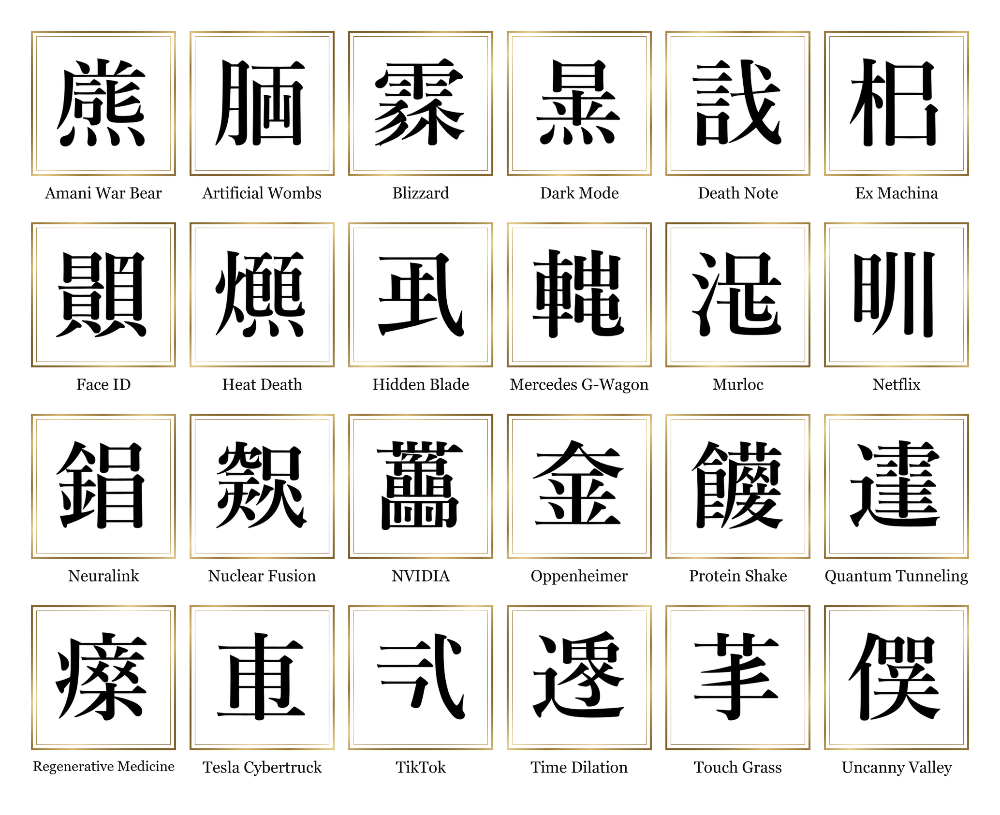
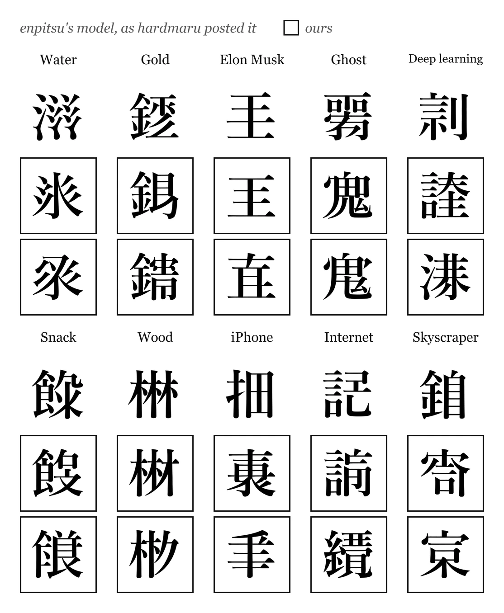
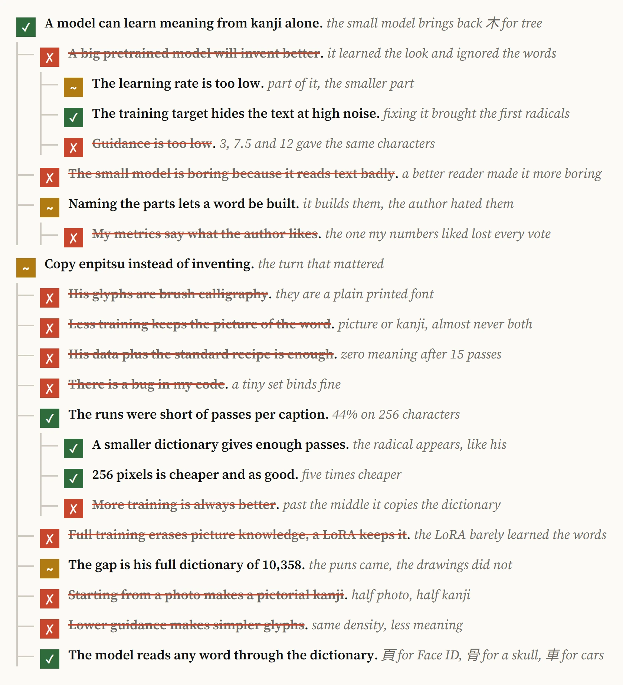
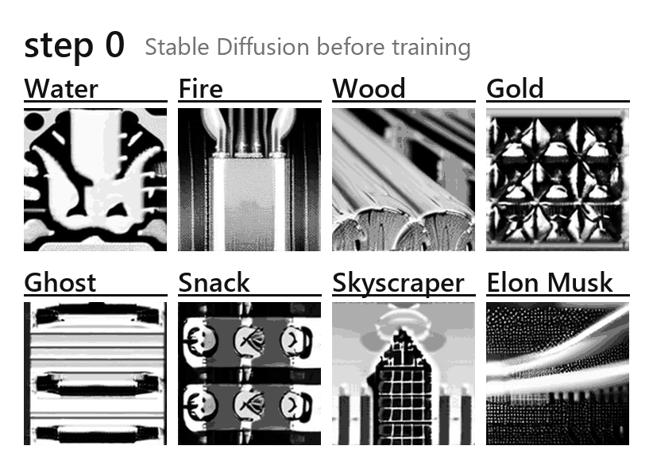
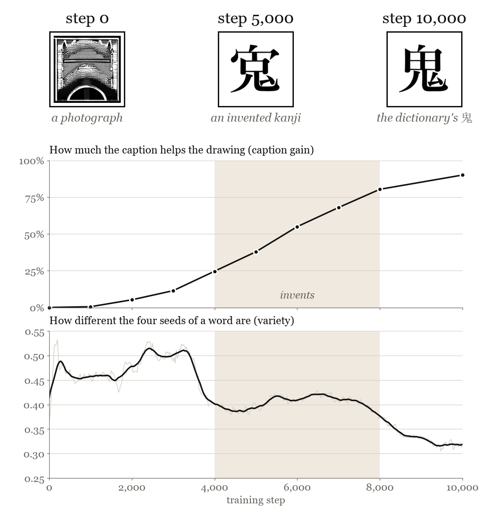
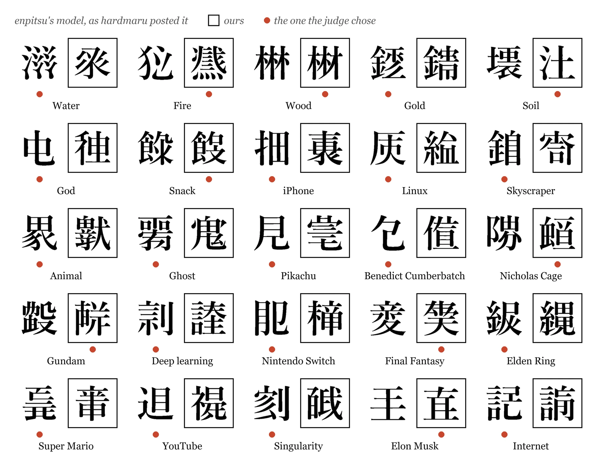
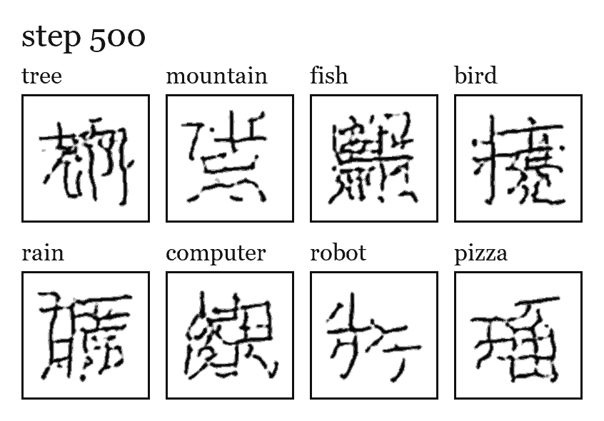

<p align="center">
  <a href="https://infraphysics.net/lab/projects/kanji-diffusion"></a>
</p>

<h1 align="center">kanji-diffusion</h1>

<p align="center">
  Fake kanji for English words, reproducing enpitsu's 2023 model.<br>
  Stable Diffusion 1.5 fine-tuned on rented GPUs, after a small latent diffusion model trained from scratch on a laptop CPU.
</p>

<p align="center">
  <b>A side project of <a href="https://infraphysics.net">InfraPhysics</a>.</b>
  The whole story, failures included, is at
  <a href="https://infraphysics.net/lab/projects/kanji-diffusion"><b>infraphysics.net/lab/projects/kanji-diffusion</b></a>
</p>

<p align="center">
  
</p>

<p align="center"><sub>One glyph per word, picked by the author from 24 samples of the Stable Diffusion fine-tune on all 10,358 kanji (arm 11).</sub></p>

---

Ask it for *Face ID* and it draws a character built on 頁, the head; *Regenerative Medicine* comes out under 疒, the radical of illness. Neither character exists. The model is Stable Diffusion 1.5 fine-tuned on the 10,358 kanji of enpitsu's training set, each captioned with its English meanings, and it reads any English word through that dictionary. The [write-up on infraphysics.net](https://infraphysics.net/lab/projects/kanji-diffusion) tells the eleven training arms it took, and [`docs/journal.md`](docs/journal.md) logs every decision with what it cost.

## Where the idea comes from

In January 2023 [@hardmaru shared](https://x.com/hardmaru/status/1611237067589095425) a grid of kanji that do not exist, each drawn for an English word. The model behind it was enpitsu's (Hugging Face user [`epts`](https://huggingface.co/epts)), Stable Diffusion fine-tuned on [ten thousand kanji with their meanings](https://x.com/enpitsu/status/1610587513059684353). hardmaru had made fake kanji years before with [sketch-rnn](https://blog.otoro.net/2015/12/28/recurrent-net-dreams-up-fake-chinese-characters-in-vector-format-with-tensorflow/), stroke by stroke and with no word behind them. enpitsu never published how he trained, and his model can no longer be downloaded, so this repository rebuilds it from his data and that one image.

<p align="center">
  
</p>

Ten of those words, his glyph on top and two of mine from arm 9 below:

<p align="center">
  
</p>

## What it took

Every guess I made about why it was not working, in the order they branched. A green tick held, an amber tilde half held, the struck-through ones were wrong:

<p align="center">
  
</p>

The turn came from copying enpitsu instead of inventing: his data with the standard recipe learned no meaning until each caption was seen often enough. Arm 9 trains on his glyphs of the Jōyō characters (about 2,100) at 256 px, with the cross-attention at ten times the learning rate of the rest, and its training shows the whole arc. Retrained to 10,000 steps with a sample every 25 steps, each word starts as Stable Diffusion's photograph of it, becomes a new character built on the word's part around step 5,000, and ends as the dictionary's own kanji:

<p align="center">
  
</p>

The model invents only while it reads the word and has not yet settled on the dictionary: between 4,000 and 8,000 steps the caption gain climbs from 25% to 80% while the four seeds of a word still differ, and past 8,000 they converge on the same real kanji.

<p align="center">
  
</p>

In a blind test against the 25 glyphs hardmaru posted, a judge chose enpitsu's in 17 pairs and mine (arm 9, step 6,000) in 8. Arm 11 then trained the same recipe on all 10,358 characters, which brought the puns of the picks at the top.

<p align="center">
  
</p>

## The small model

Before renting anything, the first arm kept Stable Diffusion's architecture at a size a laptop CPU can train overnight. It learns from the 6,413 characters that have both stroke data in [KanjiVG](https://kanjivg.tagaini.net) and English meanings in [KANJIDIC2](https://www.edrdg.org/wiki/index.php/KANJIDIC_Project):

| Stage | Stable Diffusion 1.x | kanji-diffusion |
|---|---|---|
| Image | 512×512×3 | 64×64×1 (ink) |
| Autoencoder latent | 64×64×4 | 16×16×4 (`GlyphVAE`, 1.6M params) |
| Text encoder (frozen) | CLIP ViT-L/14 | CLIP ViT-B/32 |
| Denoiser | UNet, 860M params | UNet with cross-attention, 17M params |
| Objective | ε-prediction | v-prediction, cosine schedule |
| Sampler | PNDM / DDIM | DPM-Solver++, classifier-free guidance |

Everything runs on CUDA when it is available and falls back to the CPU otherwise.

<p align="center">
  
</p>

The autoencoder (orange, trained first) turns a 64×64 glyph into a 16×16×4 latent and back;
it only ever learns to redraw. The U-Net (orange, trained second) learns on those latents to
predict what noise was added, reading the frozen CLIP embedding of the caption through
cross-attention. Sampling starts from pure noise and removes it in 30 DPM-Solver++ steps with
classifier-free guidance, then decodes once.

<p align="center">
  
</p>

Trained for 16,000 steps on an 8-core laptop CPU (AMD Ryzen AI 7 PRO 450), about five hours
for the denoiser and 45 minutes for the autoencoder. Words that have no kanji, each sample
beside the most similar of the 6,413 training characters (grey, with their ink overlap). The
model reuses the components that fit the meaning (the gate 門 for *internet*, the thread 糸
for *algorithm*) and builds new characters with them:

<p align="center">
  
</p>

Words that do have a kanji. Simple characters come back (木, 山, 女); for others the model
draws the family the meaning belongs to (魚 plus a second part for *fish*, 雨 on top for *rain*):

<p align="center">
  
</p>

The same prompts and seed during training, one frame every 500 steps from 500 to 16,000:

<p align="center">
  
</p>

`python -m kanji_diffusion.evaluate runs/small` measures how close each sample comes to its
nearest training glyph (ink overlap with strokes thickened by one pixel). Its reference is
the training set itself: the nearest *other* real kanji reaches 0.57 at the median and 0.78
at the 99th percentile. None of the 96 samples goes past that 99th percentile, so the model
draws new characters rather than returning ones it was shown. The figures are produced by
`docs/figures.py`; `docs/paper_figures.py` draws plainer versions into `docs/paper/`, with the
sampling trajectory and a guidance sweep (`pip install -e .[figures]`).

## Install

```bash
python -m venv .venv
.venv/Scripts/activate        # Windows; source .venv/bin/activate elsewhere
pip install torch --index-url https://download.pytorch.org/whl/cpu   # or a CUDA build
pip install -e .
```

## Run the small model

The weights after 16,000 steps are in the [v0.2.0 release](https://github.com/yago-mendoza/kanji-diffusion/releases/tag/v0.2.0).
Unzip `kanji-diffusion-16k.zip` into `runs/` and skip straight to step 4 below.

```bash
# 1. Download KanjiVG and KANJIDIC2, render every character at 64x64 and embed the
#    meanings with CLIP (~5 minutes). Writes data/kanji64.pt and a preview sheet.
python -m kanji_diffusion.prepare

# 2. Train the autoencoder (~1 hour on an 8-core CPU, a few minutes on a GPU).
python -m kanji_diffusion.autoencoder --steps 3000 --batch 32

# 3. Train the denoiser. It saves the EMA weights and a sample sheet every 500 steps
#    under runs/small/, and continues from its last checkpoint if restarted. The released
#    run did 10,000 steps (~3.3 h on the CPU) and was then continued to 16,000 (~2 h).
python -m kanji_diffusion.train --steps 10000
python -m kanji_diffusion.train --steps 16000

# 4. Generate.
python -m kanji_diffusion.sample runs/small "pizza" "internet" "Elon Musk" -n 4 --out outputs/sheet.png
```

`--guidance` (default 3) trades variety for fidelity to the prompt; `--seed` changes the
draw. On a GPU, `--preset base` trains a wider denoiser.

## Fine-tune Stable Diffusion (arm 11)

This needs a CUDA GPU; the run below took about 90 minutes on an 80 GB H100. The fine-tuned weights are not released.

```bash
# 1. enpitsu's training set (Hugging Face epts/kanji-full), 10,358 Mincho glyphs with their
#    KANJIDIC2 meanings, at 256 px.
python -m kanji_diffusion.prepare_epts --size 256 --out data/kanji256_epts.pt

# 2. Full U-Net fine-tune of Stable Diffusion 1.5, cross-attention at 1e-4 and the rest at 1e-5,
#    batch 32, keeping the U-Net of every save so any step can be chosen afterwards.
python -m kanji_diffusion.finetune_sd --data data/kanji256_epts.pt --eval-data /none --out runs/arm11 \
  --steps 24000 --lr 1e-5 --lr-xattn 1e-4 --constant --save-every 2000 --save-unets

# 3. 24 samples of each word at guidance 7.5, one PNG each, to pick from.
python outputs/keep/gallery.py runs/arm11/pipeline runs/arm11/gallery outputs/keep/hardmaru_words.txt --n 24
```

`python -m kanji_diffusion.diagnose runs/arm11 --data data/kanji256_epts.pt` gives the caption gain: how much
better the model removes noise with the right caption than with a shuffled one. `--lora R` trains a rank-R LoRA
instead of the whole U-Net (arm 10). The flags of every other arm are in [`docs/journal.md`](docs/journal.md).

## Layout

```
kanji_diffusion/
  prepare.py       data: KanjiVG strokes rendered without cairo, KANJIDIC2 meanings, CLIP embeddings
  prepare_font.py  every KANJIDIC2 character drawn from fonts (arm 5)
  prepare_epts.py  enpitsu's own training set in this repo's format (arms 7 to 11)
  text.py          the frozen CLIP text encoder
  autoencoder.py   GlyphVAE and its training loop
  model.py         the UNet and the noise schedule
  train.py         denoiser training with EMA and caption dropout
  sample.py        generation and labelled sample sheets
  evaluate.py      nearest-training-glyph check for dictionary and invented words
  design.py        words built from named parts, and whether the design decides the glyph (arm 4)
  diagnose.py      caption gain: right caption against a shuffled one
  finetune_sd.py   the Stable Diffusion fine-tune
  lora.py          LoRA on the attention layers, in plain torch
outputs/keep/      word lists, gallery and figure scripts of the Stable Diffusion arms
docs/
  figures.py       the figures of the small model
  journal.md       every decision of the project, with its cost
```

## Data licences

KanjiVG is © Ulrich Apel, CC BY-SA 3.0. KANJIDIC2 is © the Electronic Dictionary Research
and Development Group, CC BY-SA 4.0. Neither is redistributed here: `prepare` downloads them.
enpitsu's training set is downloaded from Hugging Face by `prepare_epts`.
