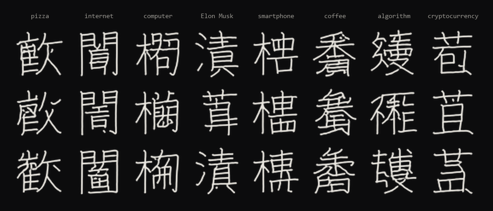
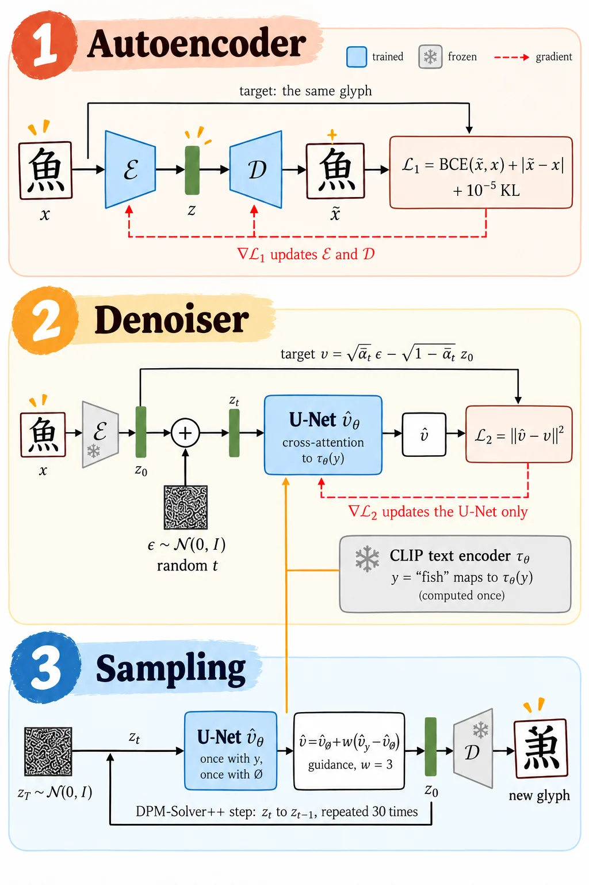
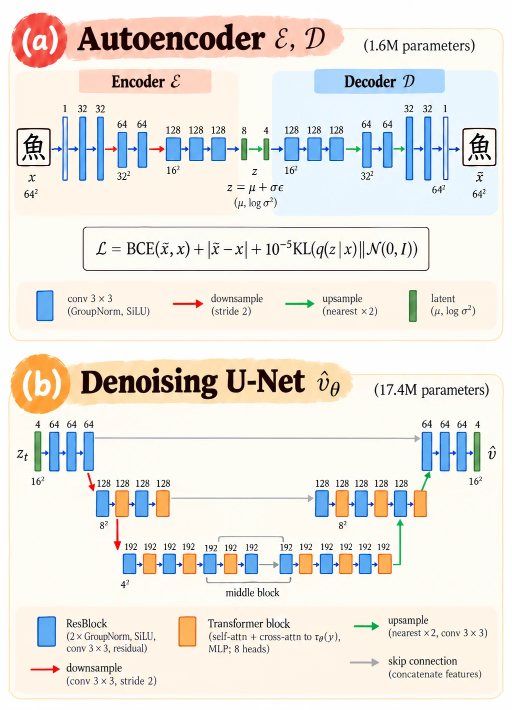
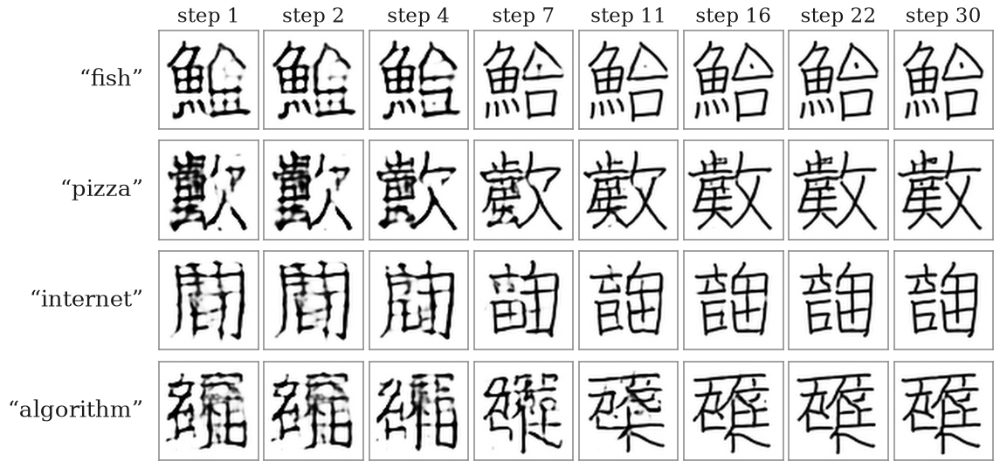
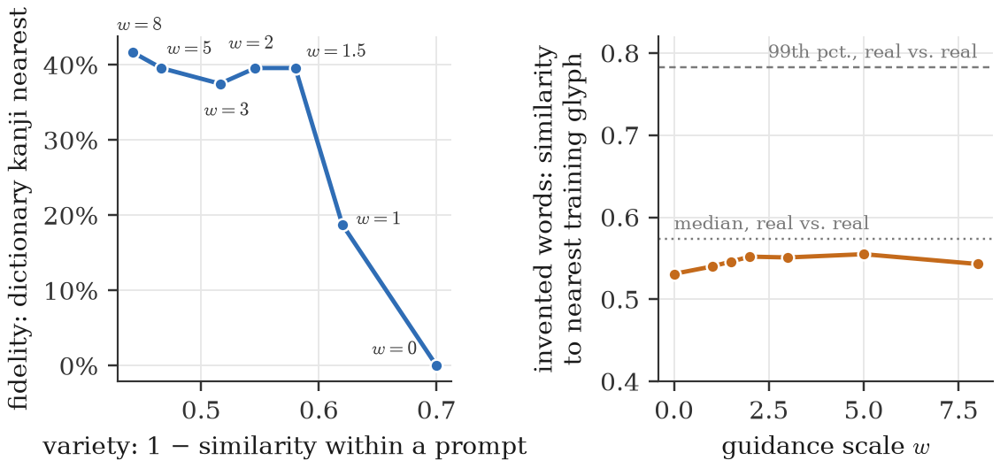
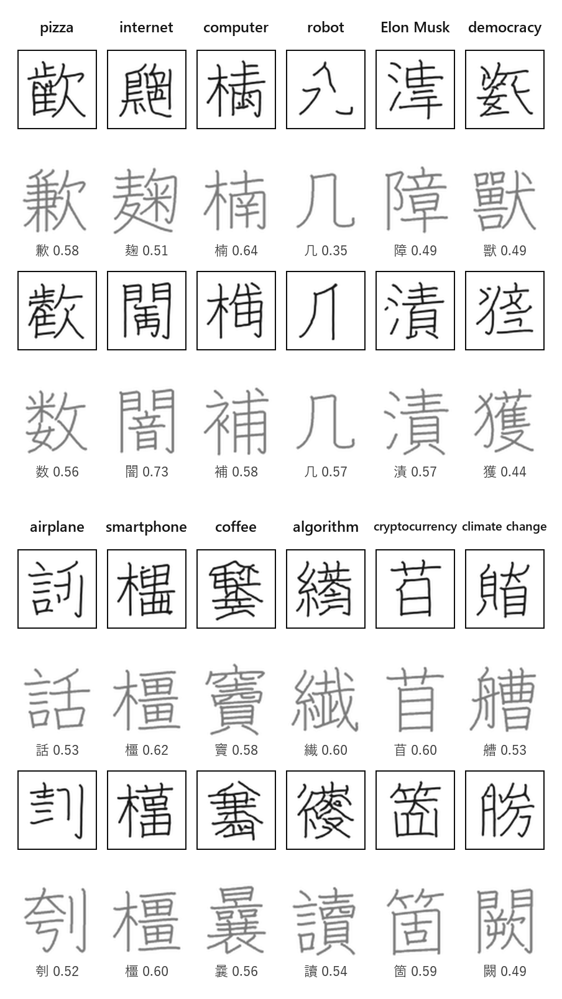
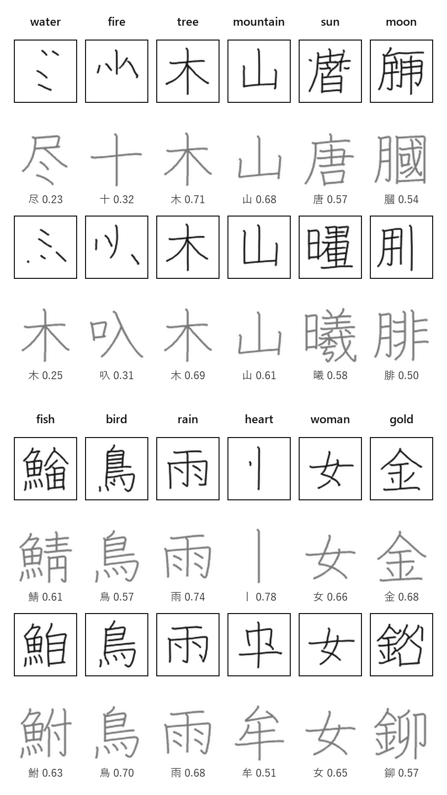
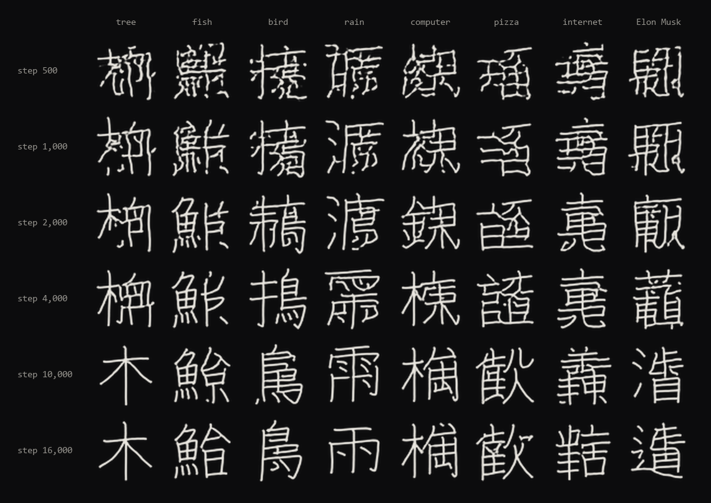
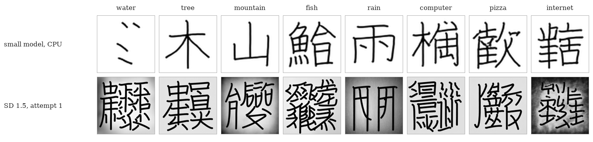
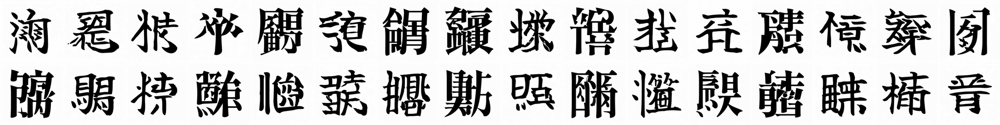

<p align="center">
  <a href="https://infraphysics.net/lab/projects/kanji-diffusion"></a>
</p>

<h1 align="center">kanji-diffusion</h1>

<p align="center">
  A small latent diffusion model that invents kanji for English words.<br>
  Stable Diffusion's recipe at 64 pixels, trained from scratch on a laptop CPU overnight.
</p>

<p align="center">
  <b>A side project of <a href="https://infraphysics.net">InfraPhysics</a>.</b>
  Every design decision, the evaluation and the second arm on a rented GPU are written up at
  <a href="https://infraphysics.net/lab/projects/kanji-diffusion"><b>infraphysics.net/lab/projects/kanji-diffusion</b></a>
</p>

<p align="center">
  
</p>

---

Ask it for *internet* and it draws a character under 門, the gate, with something of its own inside; ask for *algorithm* and it builds one on 糸, the thread. Neither character exists. The model has only ever seen real kanji, yet it has learned which component carries which meaning well enough to put together new ones. This README covers running it; the [write-up on infraphysics.net](https://infraphysics.net/lab/projects/kanji-diffusion) explains why each part is the size it is and measures the results against the training set, and a companion piece tells how the second arm was trained on [an A100 rented on RunPod from Claude Code](https://infraphysics.net/blog/bits2bricks/renting-a-gpu-on-runpod).

## Where the idea comes from

The model learns from
the 6,413 characters that have both stroke data in [KanjiVG](https://kanjivg.tagaini.net)
and English meanings in [KANJIDIC2](https://www.edrdg.org/wiki/index.php/KANJIDIC_Project),
and then draws characters that never existed for prompts like *pizza*, *internet* or
*Elon Musk*. The idea comes from a Stable Diffusion model trained on kanji images that
[@hardmaru shared in January 2023](https://x.com/hardmaru/status/1611237067589095425), itself
a modern take on his [2015 sketch-rnn fake kanji](https://blog.otoro.net/2015/12/28/recurrent-net-dreams-up-fake-chinese-characters-in-vector-format-with-tensorflow/),
also trained on KanjiVG:

<p align="center">
  
</p>

This version follows the same architecture as Stable Diffusion at a size a laptop CPU can
train overnight:

| Stage | Stable Diffusion 1.x | kanji-diffusion |
|---|---|---|
| Image | 512×512×3 | 64×64×1 (ink) |
| Autoencoder latent | 64×64×4 | 16×16×4 (`GlyphVAE`, 1.6M params) |
| Text encoder (frozen) | CLIP ViT-L/14 | CLIP ViT-B/32 |
| Denoiser | UNet, 860M params | UNet with cross-attention, 17M params |
| Objective | ε-prediction | v-prediction, cosine schedule |
| Sampler | PNDM / DDIM | DPM-Solver++, classifier-free guidance |

Everything runs on CUDA when it is available and falls back to the CPU otherwise.

## How it works

<p align="center">
  
</p>

The autoencoder (orange, trained first) turns a 64×64 glyph into a 16×16×4 latent and back;
it only ever learns to redraw. The U-Net (orange, trained second) learns on those latents to
predict what noise was added, reading the frozen CLIP embedding of the caption through
cross-attention. Sampling starts from pure noise and removes it in 30 DPM-Solver++ steps with
classifier-free guidance, then decodes once.

<p align="center">
  
</p>

<p align="center">
  
</p>

<p align="center">
  
</p>

The two diagrams above are the redrawn versions from the write-up; `docs/paper_figures.py` draws plain versions of them (`docs/paper/`), and the other two figures, from a trained run (`pip install -e .[figures]`).

## Results

Trained for 16,000 steps on an 8-core laptop CPU (AMD Ryzen AI 7 PRO 450), about five hours
for the denoiser and 45 minutes for the autoencoder.

Words that have no kanji, each sample above the most similar of the 6,413 training
characters (dimmed, with the similarity). The model reuses the components that fit the
meaning (the gate 門 for *internet*, the thread 糸 for *algorithm*) and builds new
characters with them:

<p align="center">
  
</p>

Words that do have a kanji. Simple characters come back (木, 山, 女); for others the model
draws the family the meaning belongs to (魚 plus a second part for *fish*, 雨 on top for *rain*):

<p align="center">
  
</p>

The same prompts and seed during training, at 500, 1,000, 2,000, 4,000, 10,000 and 16,000 steps:

<p align="center">
  
</p>

`python -m kanji_diffusion.evaluate runs/small` measures how close each sample comes to its
nearest training glyph (ink overlap with strokes thickened by one pixel). Its reference is
the training set itself: the nearest *other* real kanji reaches 0.57 at the median and 0.78
at the 99th percentile. None of the 96 samples goes past that 99th percentile, so the model
draws new characters rather than returning ones it was shown. The figures are produced by
`docs/figures.py`.

## Second arm: Stable Diffusion 1.5, in progress

The write-up asks what changes when the model starts from one that has seen the world. That arm fine-tunes Stable Diffusion 1.5 on a rented GPU, and it is still running; [`docs/journal.md`](docs/journal.md) logs every attempt and decision. The first fine-tune drew busier, darker glyphs than the small model, on grey backgrounds:

<p align="center">
  
</p>

The current attempt (arm 5) follows the fake kanji that started the idea more closely: 10,384 KANJIDIC2 characters instead of 6,413, drawn from a brush font and a bold mincho instead of KanjiVG's hairline strokes. At 1,000 of its 8,000 steps the brush style is already there:

<p align="center">
  
</p>

## Install

```bash
python -m venv .venv
.venv/Scripts/activate        # Windows; source .venv/bin/activate elsewhere
pip install torch --index-url https://download.pytorch.org/whl/cpu   # or a CUDA build
pip install -e .
```

## Pretrained weights

The weights after 16,000 steps are in the [v0.2.0 release](https://github.com/yago-mendoza/kanji-diffusion/releases/tag/v0.2.0).
Unzip `kanji-diffusion-16k.zip` into `runs/` and skip straight to step 4 below.

## Run

```bash
# 1. Download KanjiVG and KANJIDIC2, render every character at 64x64 and embed the
#    meanings with CLIP (~5 minutes). Writes data/kanji64.pt and a preview sheet.
python -m kanji_diffusion.prepare

# 2. Train the autoencoder (~1 hour on an 8-core CPU, a few minutes on a GPU).
python -m kanji_diffusion.autoencoder --steps 3000 --batch 32

# 3. Train the denoiser. It saves the EMA weights and a sample sheet every 500 steps
#    under runs/small/, and continues from its last checkpoint if restarted. The released
#    run did 10,000 steps (~3.3 h on the CPU) and was then continued to 16,000 (~2 h).
python -m kanji_diffusion.train --steps 10000
python -m kanji_diffusion.train --steps 16000

# 4. Generate.
python -m kanji_diffusion.sample runs/small "pizza" "internet" "Elon Musk" -n 4 --out outputs/sheet.png
```

`--guidance` (default 3) trades variety for fidelity to the prompt; `--seed` changes the
draw. On a GPU, `--preset base` trains a wider denoiser.

## Layout

```
kanji_diffusion/
  prepare.py      data: KanjiVG strokes rendered without cairo, KANJIDIC2 meanings, CLIP embeddings
  text.py         the frozen CLIP text encoder
  autoencoder.py  GlyphVAE and its training loop
  model.py        the UNet and the noise schedule
  train.py        denoiser training with EMA and caption dropout
  sample.py       generation and labelled sample sheets
  evaluate.py     nearest-training-glyph check for dictionary and invented words
docs/
  figures.py      the figures in this README
```

## Data licences

KanjiVG is © Ulrich Apel, CC BY-SA 3.0. KANJIDIC2 is © the Electronic Dictionary Research
and Development Group, CC BY-SA 4.0. Neither is redistributed here: `prepare` downloads them.
