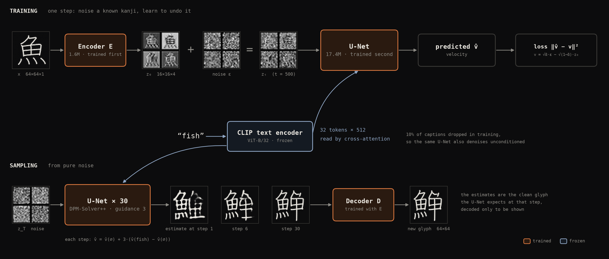
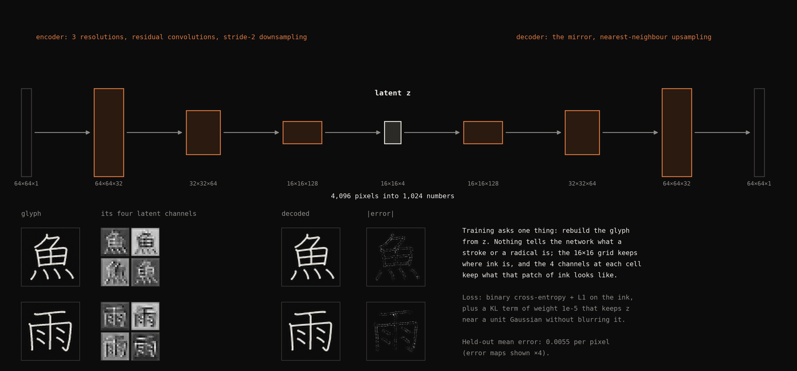
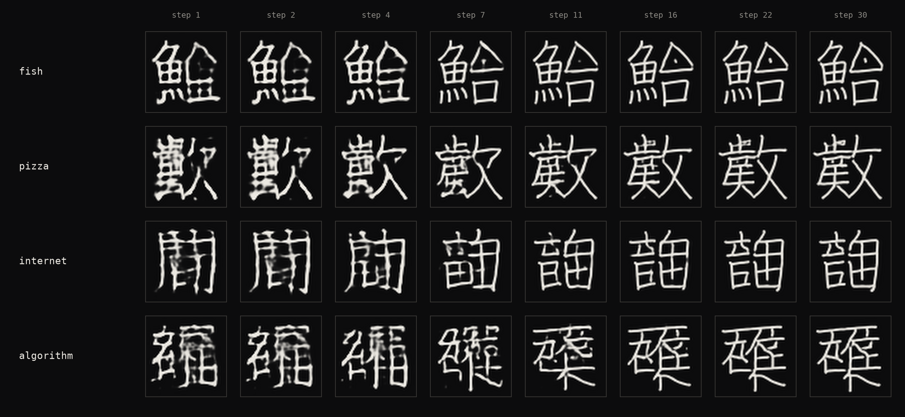
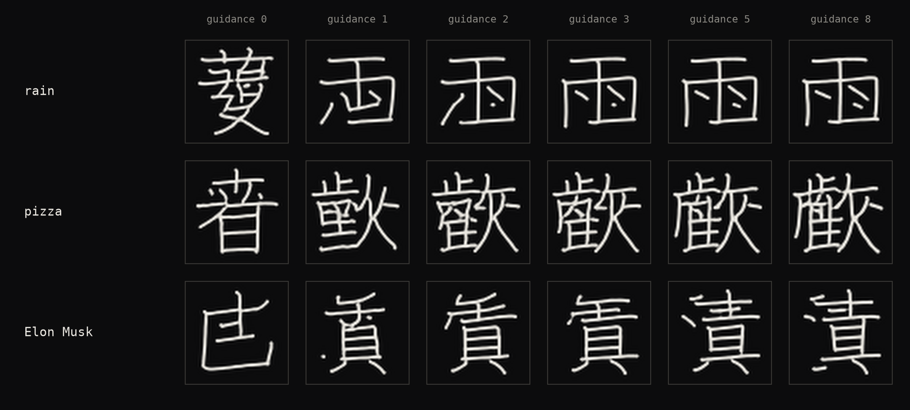
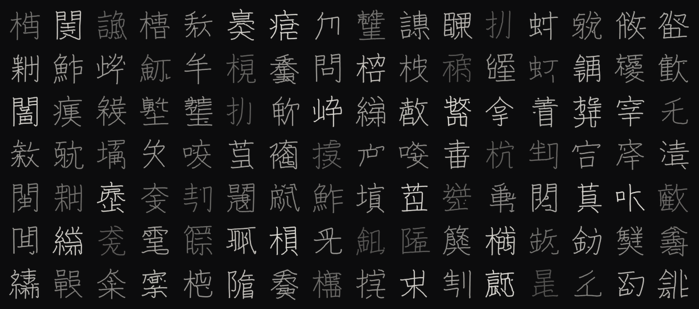

# kanji-diffusion

A small latent diffusion model that invents kanji for English words. It learns from
the 6,413 characters that have both stroke data in [KanjiVG](https://kanjivg.tagaini.net)
and English meanings in [KANJIDIC2](https://www.edrdg.org/wiki/index.php/KANJIDIC_Project),
and then draws characters that never existed for prompts like *pizza*, *internet* or
*Elon Musk*. The idea comes from a Stable Diffusion model trained on kanji images that
[@hardmaru shared in January 2023](https://x.com/hardmaru/status/1611237067589095425), itself
a modern take on his [2015 sketch-rnn fake kanji](https://blog.otoro.net/2015/12/28/recurrent-net-dreams-up-fake-chinese-characters-in-vector-format-with-tensorflow/),
also trained on KanjiVG:


This version follows the same architecture as Stable Diffusion at a size a laptop CPU can
train overnight:

| Stage | Stable Diffusion 1.x | kanji-diffusion |
|---|---|---|
| Image | 512×512×3 | 64×64×1 (ink) |
| Autoencoder latent | 64×64×4 | 16×16×4 (`GlyphVAE`, 1.6M params) |
| Text encoder (frozen) | CLIP ViT-L/14 | CLIP ViT-B/32 |
| Denoiser | UNet, 860M params | UNet with cross-attention, 17M params |
| Objective | ε-prediction | v-prediction, cosine schedule |
| Sampler | PNDM / DDIM | DPM-Solver++, classifier-free guidance |

Everything runs on CUDA when it is available and falls back to the CPU otherwise.

## How it works



The autoencoder (orange, trained first) turns a 64×64 glyph into a 16×16×4 latent and back;
it only ever learns to redraw. The U-Net (orange, trained second) learns on those latents to
predict what noise was added, reading the frozen CLIP embedding of the caption through
cross-attention. Sampling starts from pure noise and removes it in 30 DPM-Solver++ steps with
classifier-free guidance, then decodes once.







`docs/paper_figures.py` draws these from a trained run (`pip install -e .[figures]`).

## Results

Trained for 16,000 steps on an 8-core laptop CPU (AMD Ryzen AI 7 PRO 450), about five hours
for the denoiser and 45 minutes for the autoencoder.



Words that have no kanji, each sample above the most similar of the 6,413 training
characters (dimmed, with the similarity). The model reuses the components that fit the
meaning (the gate 門 for *internet*, the thread 糸 for *algorithm*) and builds new
characters with them:


Words that do have a kanji. Simple characters come back (木, 山, 女); for others the model
draws the family the meaning belongs to (魚 plus a second part for *fish*, 雨 on top for *rain*):


The same prompts and seed during training, at 500, 1,000, 2,000, 4,000, 10,000 and 16,000 steps:


`python -m kanji_diffusion.evaluate runs/small` measures how close each sample comes to its
nearest training glyph (ink overlap with strokes thickened by one pixel). Its reference is
the training set itself: the nearest *other* real kanji reaches 0.57 at the median and 0.78
at the 99th percentile. None of the 96 samples goes past that 99th percentile, so the model
draws new characters rather than returning ones it was shown. The figures are produced by
`docs/figures.py`.

## Install

```bash
python -m venv .venv
.venv/Scripts/activate        # Windows; source .venv/bin/activate elsewhere
pip install torch --index-url https://download.pytorch.org/whl/cpu   # or a CUDA build
pip install -e .
```

## Run

```bash
# 1. Download KanjiVG and KANJIDIC2, render every character at 64x64 and embed the
#    meanings with CLIP (~5 minutes). Writes data/kanji64.pt and a preview sheet.
python -m kanji_diffusion.prepare

# 2. Train the autoencoder (~1 hour on an 8-core CPU, a few minutes on a GPU).
python -m kanji_diffusion.autoencoder --steps 3000 --batch 32

# 3. Train the denoiser. It saves the EMA weights and a sample sheet every 500 steps
#    under runs/small/, and continues from its last checkpoint if restarted. The released
#    run did 10,000 steps (~3.3 h on the CPU) and was then continued to 16,000 (~2 h).
python -m kanji_diffusion.train --steps 10000
python -m kanji_diffusion.train --steps 16000

# 4. Generate.
python -m kanji_diffusion.sample runs/small "pizza" "internet" "Elon Musk" -n 4 --out outputs/sheet.png
```

`--guidance` (default 3) trades variety for fidelity to the prompt; `--seed` changes the
draw. On a GPU, `--preset base` trains a wider denoiser.

## Layout

```
kanji_diffusion/
  prepare.py      data: KanjiVG strokes rendered without cairo, KANJIDIC2 meanings, CLIP embeddings
  text.py         the frozen CLIP text encoder
  autoencoder.py  GlyphVAE and its training loop
  model.py        the UNet and the noise schedule
  train.py        denoiser training with EMA and caption dropout
  sample.py       generation and labelled sample sheets
  evaluate.py     nearest-training-glyph check for dictionary and invented words
docs/
  figures.py      the figures in this README
```

## Data licences

KanjiVG is © Ulrich Apel, CC BY-SA 3.0. KANJIDIC2 is © the Electronic Dictionary Research
and Development Group, CC BY-SA 4.0. Neither is redistributed here: `prepare` downloads them.
